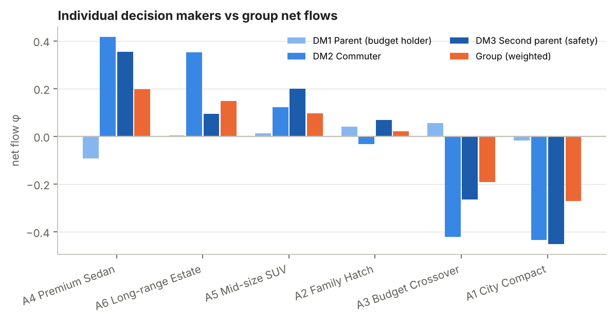
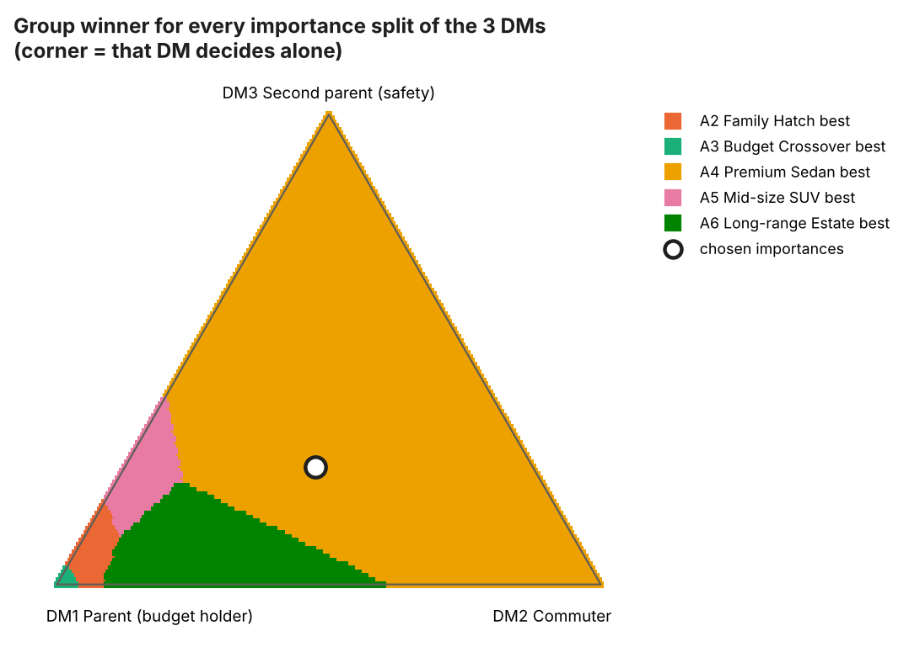

# Task 2 – PROMETHEE analysis of the Task 1 MCDM problem

> **Data note.** The repository did not contain the Task 1 data, so this
> analysis uses an example problem (choosing an electric car for a family,
> 6 alternatives × 5 criteria). All the data is in
> [`data/problem.json`](data/problem.json). To use the Task 1 problem instead,
> replace that file and run `python run_analysis.py`. Every table and figure
> is regenerated, but the written interpretation in this report must then be
> updated by hand.

**Tool choice.** I used my own Python code (`promethee/`, numpy only) and did
**not** use Visual PROMETHEE. In line with the task rules, no output of this
code was fed into VP, and no VP-specific output was recreated. That is why the
report has no GAIA plane. Because VP is not used, the sensitivity analysis is
extended (Section 5), and the chosen extension is **group decision-making**
(Section 6).

All numbers below come from [`results/results.md`](results/results.md) and the
CSV files in `results/`.

---

## 1. Problem definition

| | Price [kPLN] | Range WLTP [km] | Charging 10–80 % [min] | Boot [l] | Safety & equipment [1–10] |
|---|---|---|---|---|---|
| **A1** City Compact | 140 | 320 | 35 | 300 | 6 |
| **A2** Family Hatch | 185 | 420 | 30 | 385 | 8 |
| **A3** Budget Crossover | 150 | 380 | 45 | 450 | 6 |
| **A4** Premium Sedan | 260 | 560 | 22 | 470 | 9 |
| **A5** Mid-size SUV | 215 | 480 | 28 | 520 | 8 |
| **A6** Long-range Estate | 230 | 600 | 25 | 580 | 7 |
| direction | min | max | min | max | max |
| preference function | V-shape with indifference (type V) | type V | V-shape (type III) | level (type IV) | usual (type I) |
| thresholds | q = 5, p = 40 | q = 20, p = 120 | p = 20 | q = 50, p = 150 | – |
| base weight | 0.30 | 0.25 | 0.15 | 0.15 | 0.15 |

**Why these preference functions**

* **Price and range** use the linear function with an indifference zone. A
  difference of a few thousand PLN or a few km does not matter. Preference then
  grows steadily and becomes full at 40 kPLN or 120 km.
* **Charging time** uses V-shape: every minute counts, and 20 minutes counts as
  a full preference.
* **Boot capacity** uses the level function, because people judge it in steps
  ("the pram fits / doesn't fit").
* **Safety & equipment** uses the usual criterion. The score is already an
  ordinal expert grade, so any better grade counts as a strict preference.

## 2. PROMETHEE II – complete ranking


| Rank | Alternative | φ+ | φ− | φ (net) |
|---|---|---|---|---|
| 1 | **A6 Long-range Estate** | 0.475 | 0.292 | **+0.183** |
| 2 | A4 Premium Sedan | 0.450 | 0.308 | +0.142 |
| 3 | A5 Mid-size SUV | 0.376 | 0.301 | +0.075 |
| 4 | A2 Family Hatch | 0.348 | 0.359 | −0.011 |
| 5 | A3 Budget Crossover | 0.281 | 0.432 | −0.150 |
| 6 | A1 City Compact | 0.264 | 0.503 | −0.239 |

**Final ranking: A6 ≻ A4 ≻ A5 ≻ A2 ≻ A3 ≻ A1.**

**How far apart the alternatives are**

* The gap between the top two is the smallest at the top of the ranking
  (Δφ = 0.041). A6 wins, but not by much. The sensitivity analysis shows this
  gap is the one that matters most.
* A2 sits almost exactly at φ ≈ 0. It is the neutral middle option: neither
  preferred to the rest nor dominated by it.
* There is a clear break between the three better-equipped cars (A6, A4, A5,
  φ > 0) and the three cheap ones (A2, A3, A1). The largest gap is A2 → A3
  (Δφ = 0.139).

**Strengths and weaknesses by criterion** (unicriterion net flows φⱼ):


* **A6** is best or second-best on range (+0.84), boot (+0.70) and charging
  (+0.35). Its weak points are price (−0.51) and a mediocre safety score
  (−0.20). It wins because it has no large weakness on any criterion.
* **A4** has the best profile on safety (+1.00), range and charging, but it is
  by far the most expensive (−0.94 on price, the worst value in the table).
  Price carries the largest weight (0.30), so this one weakness pushes A4 to
  second place.
* **A1 and A3** win clearly on price (+0.83 and +0.74) and lose on almost
  everything else. A3 also has the slowest charging of all (−0.82).

## 3. PROMETHEE I – partial ranking


The partial preorder is:

```
            A6
          /    \
        A4  R   A5        (A4 and A5 incomparable)
          \    /
            A2
            |
            A3
            |
            A1
```

* **A6 outranks every other alternative in PROMETHEE I**: it has the highest
  φ+ and the lowest φ−. So A6 is the best choice in the partial ranking too,
  not just in the complete one.
* **A4 and A5 are incomparable**. A4 has the higher φ+ (0.450 vs 0.376) because
  it is strong on many criteria. A5 has the lower φ− (0.301 vs 0.308) because
  it is weak on fewer criteria, and in particular it is not dramatically
  expensive. These are two different profiles: a high-end specialist and a
  balanced compromise. PROMETHEE II puts A4 above A5, but PROMETHEE I warns
  that this order hides a real trade-off.
* The lower part of the ranking (A2 ≻ A3 ≻ A1) is the same in both methods.

## 4. Comparison of rankings

### 4.1 Different weight configurations

| Scenario | C1 price | C2 range | C3 charge | C4 boot | C5 safety | PROMETHEE II ranking | τ vs base |
|---|---|---|---|---|---|---|---|
| Base | 0.30 | 0.25 | 0.15 | 0.15 | 0.15 | A6 ≻ A4 ≻ A5 ≻ A2 ≻ A3 ≻ A1 | 1.00 |
| **Equal (0.2 each)** | 0.20 | 0.20 | 0.20 | 0.20 | 0.20 | **A4** ≻ A6 ≻ A5 ≻ A2 ≻ A3 ≻ A1 | 0.87 |
| Cost-oriented | 0.50 | 0.15 | 0.10 | 0.10 | 0.15 | **A3** ≻ A2 ≻ A1 ≻ A5 ≻ A6 ≻ A4 | −0.60 |
| Travel-oriented | 0.15 | 0.40 | 0.25 | 0.10 | 0.10 | A6 ≻ A4 ≻ A5 ≻ A2 ≻ A3 ≻ A1 | 1.00 |
| Practicality | 0.15 | 0.15 | 0.10 | 0.35 | 0.25 | **A4** ≻ A6 ≻ A5 ≻ A2 ≻ A3 ≻ A1 | 0.87 |
| Safety-first | 0.20 | 0.15 | 0.10 | 0.15 | 0.40 | **A4** ≻ A5 ≻ A2 ≻ A6 ≻ A3 ≻ A1 | 0.60 |


* **With equal weights (0.2 each)**, A4 and A6 swap places. Lowering the price
  weight from 0.30 to 0.20 is enough for the expensive A4 to win.
* **The cost-oriented scenario almost reverses the ranking** (τ = −0.60). The
  cheap cars A3, A2 and A1 move to the top and A4 drops to last. This is the
  only scenario that changes the overall structure of the ranking.
* The **travel-oriented** scenario gives exactly the base ranking. Range and
  charging are where A6 and A4 are already strongest, so giving them more
  weight changes nothing.
* **Safety-first** drops A6 to 4th place. A6's weak safety score (7) becomes
  costly.
* **Stable across all scenarios except cost-oriented:** A1 and A3 are always
  in the bottom two, A5 is always 2nd or 3rd, and A2 is always 3rd or 4th.

### 4.2 PROMETHEE vs. weighted sum (P × W)

For comparison I computed a simple additive score: the min–max normalised
performance matrix multiplied by the weight vector, S = N·w.

| Scenario | Kendall τ (PROMETHEE II vs P×W) | Difference |
|---|---|---|
| Base | 1.00 | identical |
| Equal (0.2) | 1.00 | identical |
| Travel-oriented | 1.00 | identical |
| Cost-oriented | 0.87 | P×W puts A2 first, PROMETHEE puts A3 first |
| Practicality | 0.87 | P×W puts A6 first, PROMETHEE puts A4 first |
| Safety-first | 0.87 | P×W: A6 3rd and A2 4th; PROMETHEE: A2 3rd and A6 4th |

The two methods agree on the base ranking. That strengthens the
recommendation, because it does not depend on the aggregation method. Where
they differ, the cause is how PROMETHEE treats differences in performance:

* P×W is fully **compensatory and linear**. A 1-point gap in safety
  (9 vs 8) is worth exactly as much as half of a 2-point gap. Under the usual
  criterion, PROMETHEE counts that 1-point gap as a *full* preference. A4 has
  the best safety score, so it benefits whenever safety gets a large weight
  (Practicality, Safety-first).
* The p-thresholds cap how much a large advantage can count. In P×W, A1's
  80-kPLN price advantage over A2 keeps adding to its score, but PROMETHEE
  stops at "fully preferred" once the gap reaches 40 kPLN. The indifference
  thresholds q, on the other hand, ignore small gaps. This explains the
  different winners in the cost-oriented scenario.

## 5. Sensitivity analysis

### 5.1 Weight stability intervals (exact)

PROMETHEE II net flows are linear in the weights: φ(a) = Σⱼ wⱼ φⱼ(a). So when
one weight changes and the others are rescaled proportionally, each pair of
alternatives can swap order at most once, and the swap point can be computed
exactly (`stability_intervals`).

| Criterion | Base w | Full ranking unchanged for w ∈ | A6 stays best for w ∈ | What changes outside |
|---|---|---|---|---|
| C1 Price | 0.30 | [0.226, 0.365] | [0.226, 0.447] | < 0.226: A4 becomes 1st; > 0.447: A3 becomes 1st |
| C2 Range | 0.25 | [0.147, 1.000] | [0.117, 1.000] | < 0.147: A5 moves ahead of A4 |
| C3 Charging | 0.15 | [0.000, 0.265] | [0.000, 0.333] | > 0.265: A1/A3 swap; > 0.333: A4 1st |
| C4 Boot | 0.15 | [0.074, 0.369] | [0.074, 1.000] | > 0.369: A3/A2 swap; < 0.074: A4 1st |
| C5 Safety | 0.15 | [0.043, 0.178] | [0.000, 0.178] | **> 0.178: A4 becomes 1st** |


* **The choice of A6 is most sensitive to the safety weight.** Raising it from
  0.15 to 0.18 (+0.03) is enough for A4 to win. Lowering the price weight below
  0.226 has the same effect. So the decision between A6 and A4 comes down to
  how much the family is willing to pay for top safety.
* **Range is the most robust criterion.** Any range weight from 0.117 to 1
  keeps A6 first, because A6 has the longest range.
* **Price is the most influential criterion overall.** Its line crossings are
  the steepest (see the C1 panel): above roughly 0.45 the whole ranking flips
  toward the cheap cars.

### 5.2 Monte-Carlo rank acceptability (20 000 weight vectors)


| | ±20 % around base | ±50 % around base | any weights (uniform) |
|---|---|---|---|
| P(A6 is 1st) | **93 %** | **67 %** | 38 % |
| P(A4 is 1st) | 7 % | 28 % | **48 %** |
| P(A5 is 1st / 2nd / 3rd) | 0 / 1 / 99 % | 1 / 15 / 82 % | 1 / 26 / 63 % |
| P(A1 is last) | 100 % | 94 % | 63 % |
| mean rank A6 / A4 | 1.07 / 1.94 | 1.40 / 2.14 | 2.28 / 2.14 |

* If the base weights are roughly right (±20 %), **A6 is first in 93 % of
  cases**, and ranks 3–6 never change.
* Even with ±50 % uncertainty, A6 is still the most likely winner (67 %).
* With no information about the weights at all, A4 wins slightly more often
  (48 % vs 38 %). Equal-ish random weights give price relatively less weight
  than the base does. **A6 vs A4 is the only real dilemma.**
* **A5 is never first but almost always 2nd or 3rd.** It is the robust
  compromise choice for a cautious decision maker.
* **A1 and A3 are first only under extreme weights** (about 4–5 % of random
  vectors). For practical purposes they can be excluded.

### 5.3 Sensitivity to preference functions and thresholds

| Variant | Ranking | τ vs base |
|---|---|---|
| all thresholds × 0.25 | A6 ≻ A5 ≻ A4 ≻ A2 ≻ A3 ≻ A1 | 0.87 |
| all thresholds × 0.5 … × 1.25 | identical to base | 1.00 |
| all thresholds × 1.5 / × 2 | A4 ≻ A6 ≻ A5 ≻ A2 ≻ A3 ≻ A1 | 0.87 |
| all criteria "usual" (type I) | identical to base | 1.00 |


* The ranking does not change when all thresholds are scaled anywhere from
  ×0.5 to ×1.25, so the parameter choice is not driving the result.
* Very large thresholds (×1.5 and above) favour A4. With larger p, A4's large
  price gap no longer counts as a full preference against it, so its price
  penalty shrinks.
* Very small thresholds (×0.25) bring A5 ahead of A4.
* None of these variants moves anything outside the top three.

## 6. Extension – group decision-making (PROMETHEE GDSS)

**Why this extension.** Buying a family car is a joint decision by several
people with different priorities. Sorting (SORT) is not useful here because
there is no reference class to assign alternatives to. A portfolio approach
(PROMETHEE V) is not useful either, because only one car is bought.

**Method.** Each decision maker k has their own weights wᵏ, and everyone shares
the performance table and preference functions. Individual net flows φᵏ are
aggregated with importance coefficients λₖ:
φ_group = Σₖ λₖ φᵏ. Because the flows are linear in the weights, this is the
same as running PROMETHEE II with the weights Σₖ λₖ wᵏ (checked in
`tests/test_promethee.py`).

| DM | λ | C1 | C2 | C3 | C4 | C5 | Individual ranking | τ vs group |
|---|---|---|---|---|---|---|---|---|
| DM1 Parent (budget holder) | 0.40 | 0.45 | 0.15 | 0.10 | 0.15 | 0.15 | A3 ≻ A2 ≻ A5 ≻ A6 ≻ A1 ≻ A4 | −0.47 |
| DM2 Commuter | 0.35 | 0.15 | 0.40 | 0.25 | 0.05 | 0.15 | A4 ≻ A6 ≻ A5 ≻ A2 ≻ A3 ≻ A1 | 1.00 |
| DM3 Second parent (safety) | 0.25 | 0.20 | 0.10 | 0.05 | 0.25 | 0.40 | A4 ≻ A5 ≻ A6 ≻ A2 ≻ A3 ≻ A1 | 0.87 |

**Group ranking:** **A4 (+0.197) ≻ A6 (+0.148) ≻ A5 (+0.097)** ≻ A2 (+0.021)
≻ A3 (−0.192) ≻ A1 (−0.272)




* **DM2 and DM3 largely agree** (τ = 0.87). **DM1 disagrees with both**
  (τ = −0.47 and −0.33): DM1's priority is the purchase price.
* The group picks **A4**, which is DM1's *last* choice. This is not a
  calculation error. DM1's net flows are all close to zero (between −0.09 and
  +0.05). The budget holder sees the cars as roughly equivalent, so DM1's
  ranking has little "strength". DM2 and DM3 have strong, consistent
  preferences that dominate the weighted sum even though DM1 has the largest
  importance (0.40). This is a known property of flow-based GDSS aggregation,
  and the decision makers should be told about it before the result is used.
* **Robustness to the importance split.** In the triangle above, each point is
  one possible split of importance between the three DMs, coloured by the
  alternative that wins. A4 wins over most of the triangle. For random DM
  importances it is the group winner in **82 %** of cases (A6 12 %, A5 4 %).
  A6 wins when DM1 and DM2 together hold most of the importance and DM3 has
  little. A2 and A3 win only when DM1 decides almost alone.
* **A5 is a reasonable compromise.** It is 3rd for DM1, 3rd for DM2 and 2nd
  for DM3, and it is nobody's worst option.

## 7. Conclusions

1. **Recommendation with the base weights: A6 Long-range Estate.** It is first
   in PROMETHEE II, outranks every alternative in PROMETHEE I, gives the same
   result with the weighted sum (P×W), and stays first for ±20 % weight
   uncertainty in 93 % of cases.
2. **The real decision is between A6 and A4.** A4 wins under equal weights,
   with a higher safety weight (above 0.178) or a lower price weight (below
   0.226), and in the group setting (82 % of importance splits). In short: if
   the family values top safety more than about 20 kPLN in savings over A6,
   A4 is the better choice.
3. **A5 Mid-size SUV is the safe compromise.** It is incomparable with A4 in
   PROMETHEE I, almost always 2nd or 3rd, and acceptable to every decision
   maker.
4. **A1 and A3 should be rejected** unless price gets more than about 45 % of
   the total weight. Their cheapness cannot make up for weak range, charging
   and safety.
5. **Most influential criteria:** price (the steepest changes, and the only
   one that can flip the whole ranking) and safety (the narrowest stability
   interval). The result hardly depends on the range weight or on the exact
   threshold values.

---

### Reproducing

```bash
pip install -r requirements.txt
python run_analysis.py              # or: python run_analysis.py my_problem.json
python -m pytest -q
```
