# Task 2 – PROMETHEE for my Task 1 problem: which 3D printer should I buy?

**Problem (from Task 1, `KK_MCDM_1.xlsx`).** I want to buy an FDM printer for
home. The budget is at most 2500 EUR, and the printer will stand in my room, so
noise matters. I compare 4 printers on 6 criteria. The performance data and
both weighting methods are copied unchanged from the Task 1 spreadsheet.

**Tool choice.** I used my own Python code (`promethee/`, numpy only) and did
not use Visual PROMETHEE. In line with the task rules, nothing from this code
was put into VP, and no VP-specific output (e.g. the GAIA plane) was recreated.
Because VP is not used, the sensitivity analysis is extended (Section 5:
exact weight stability intervals, Monte-Carlo weight sensitivity and thresholds).
Uncertainty in the decision matrix is handled with **F-PROMETHEE** (triangular
fuzzy numbers, Section 5.4), and the chosen extension is **efficiency
measuring** (Section 6).

All tables come from [`results/results.md`](results/results.md) and
`results/*.csv`. To regenerate everything, run `python run_analysis.py`.

---

## 1. Data and PROMETHEE parameters

| Printer | Price [EUR] | Noise [dB(A)] | Max speed [mm/s] | Build volume [dm³] | Ease of use [1–5] | Nozzles |
|---|---|---|---|---|---|---|
| **A1** Creality K2 Plus Combo | 1187 | 50 | 600 | 42.875 | 3 | 1 |
| **A2** Snapmaker U1 | 899 | 55 | 500 | 19.683 | 4 | 4 |
| **A3** Bambu Lab H2D | 2125 | 49.1 | 1000 | 33.8 | 5 | 2 |
| **A4** Prusa CORE One | 1282 | 48 | 600 | 14.85 | 4 | 1 |
| direction | min | min | max | max | max | max |
| weight – M1 points (**base**) | 0.30 | 0.15 | 0.10 | 0.12 | 0.08 | 0.25 |
| weight – M2 rank sum | 0.286 | 0.190 | 0.095 | 0.143 | 0.048 | 0.238 |

All four printers pass the Task 1 "must pass" limits.

**Preference functions.** PROMETHEE needs to know how a *difference* between
two printers turns into a preference. I chose these myself as the decision
maker. q is the largest difference I consider negligible; p is the smallest
difference I consider decisive:

| Criterion | Function | q | p | Why |
|---|---|---|---|---|
| Price | linear (type V) | 50 € | 300 € | Price is very important to me. Up to 50 € difference doesn't matter, but already 300 € (about 12 % of the budget, a third of the cheapest printer) makes the cheaper printer clearly better. |
| Noise | linear (type V) | 2 dB | 7 dB | In Task 1 I noted that the noise values come from different sources, so 1–3 dB differences "don't really mean much". q = 2 dB reflects that. About 7 dB is very audible. |
| Max speed | linear (type V) | 50 mm/s | 400 mm/s | Small speed differences are not noticeable in practice. |
| Build volume | linear (type V) | 2 dm³ | 20 dm³ | About 2 dm³ is noise; 20 dm³ is a different class of printer. |
| Ease of use | level (type IV) | 0.5 | 1.5 | This is an ordinal score I gave myself: a difference of 1 point → preference 0.5, 2 or more points → 1. |
| Nozzles | V-shape (type III) | – | 3 | Every extra nozzle counts; 1 vs 4 nozzles is a full preference. |

## 2. PROMETHEE II – complete ranking (base weights M1)

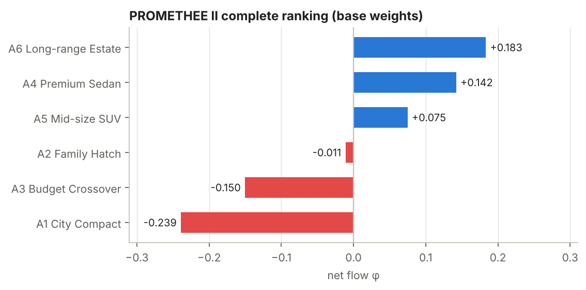

| Rank | Printer | φ+ | φ− | φ |
|---|---|---|---|---|
| 1 | **A2 Snapmaker U1** | 0.537 | 0.242 | **+0.295** |
| 2 | A1 Creality K2 Plus Combo | 0.249 | 0.293 | −0.044 |
| 3 | A3 Bambu Lab H2D | 0.313 | 0.371 | −0.059 |
| 4 | A4 Prusa CORE One | 0.168 | 0.360 | −0.192 |

**Final ranking: U1 ≻ K2 Plus ≻ H2D ≻ CORE One.** Method M2 (rank sum) gives
exactly the same order.

**How far apart the printers are**

* **The Snapmaker U1 is a clear winner.** Its lead over 2nd place is
  Δφ = 0.339, more than twice the whole spread between places 2 and 4 (0.147).
  It is the only printer with a positive net flow.
* **Places 2 and 3 are almost tied.** K2 Plus and H2D differ by only
  Δφ = 0.014, so their order should not be over-interpreted.
* **The Prusa CORE One is last.** It has no strong point except low noise.

**Strengths and weaknesses** (unicriterion net flows φⱼ):

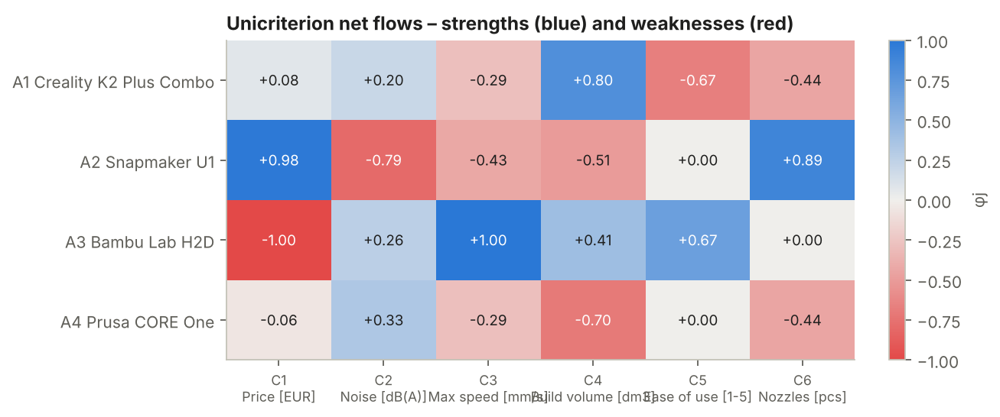

* **U1**
  * Strong on the two criteria I weighted most: price (+0.98, the cheapest by
    almost 300 €) and nozzles (+0.89, 4 toolheads).
  * Weak on noise (−0.79, the loudest at 55 dB), build volume (−0.51) and
    speed (−0.43).
  * Noise has only 15 % of the weight, so this weakness is not enough to stop
    it winning.
* **H2D**
  * Best on speed (+1.0) and ease of use (+0.67); good on noise and volume.
  * **Its price is −1.0.** It is more than 300 € (= p) more expensive than
    every other printer, so on price it is fully dominated by all three. The
    most important criterion (30 %) works entirely against it.
* **K2 Plus**
  * By far the largest build volume (+0.80); price only average (+0.08),
    because U1 is 288 € cheaper.
  * Lowest ease of use (−0.67) and only one nozzle (−0.44).
* **CORE One**
  * Quiet (+0.33).
  * The smallest build volume (−0.70) and one nozzle (−0.44).

## 3. PROMETHEE I – partial ranking

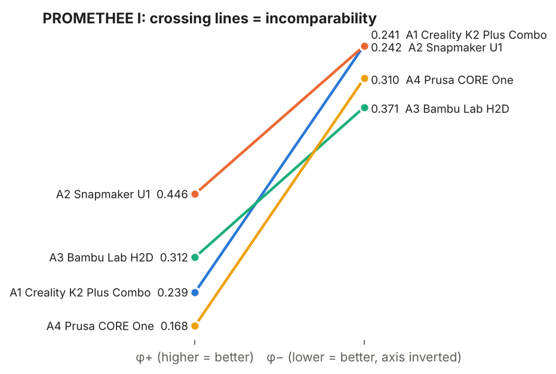

| | relation |
|---|---|
| U1 vs K2 Plus, U1 vs H2D, U1 vs CORE One | **U1 outranks all three** (higher φ+ *and* lower φ−) |
| K2 Plus vs CORE One | K2 Plus outranks |
| K2 Plus vs H2D, H2D vs CORE One | incomparable |

* **U1 is the best choice in the partial ranking too.** It has the highest
  φ+ (0.537) and the lowest φ− (0.242), so it outranks every other printer.
  This makes the recommendation stronger: PROMETHEE I and II agree on it.
* **H2D is incomparable with both K2 Plus and CORE One.** This is a real
  conflict of profiles. H2D has strong advantages (speed, ease of use) and one
  huge disadvantage (price). The other two are average everywhere.
  PROMETHEE II puts H2D 3rd, but PROMETHEE I warns that its position depends
  on how price is traded against quality.

## 4. Comparison of rankings

### 4.1 Different weight configurations

The first two rows are the Task 1 weighting methods. The last three are the
Task 1 "what if my weights were different?" cases. I added "Equal (1/6 each)"
and "0.2 / 0.15 balanced" (0.2 for my two key criteria, 0.15 for the others).

| Weights | Price | Noise | Speed | Volume | Ease | Nozzles | PROMETHEE II ranking | τ vs base |
|---|---|---|---|---|---|---|---|---|
| **M1 points (base)** | .30 | .15 | .10 | .12 | .08 | .25 | **U1** ≻ K2 ≻ H2D ≻ Prusa | 1.00 |
| M2 rank sum | .286 | .190 | .095 | .143 | .048 | .238 | **U1** ≻ K2 ≻ H2D ≻ Prusa | 1.00 |
| Equal (1/6 each) | .167 | .167 | .167 | .167 | .167 | .167 | **H2D** ≻ U1 ≻ K2 ≻ Prusa | 0.33 |
| 0.2 / 0.15 balanced | .20 | .15 | .15 | .15 | .15 | .20 | **H2D** ≻ U1 ≻ K2 ≻ Prusa | 0.33 |
| Price matters less | .10 | .19 | .13 | .15 | .10 | .33 | **H2D** ≻ U1 ≻ K2 ≻ Prusa | 0.33 |
| No multi-colour needed | .40 | .20 | .133 | .16 | .107 | 0 | **U1** ≻ K2 ≻ H2D ≻ Prusa (U1 +0.097 vs K2 +0.089) | 1.00 |
| Big prints | .25 | .12 | .08 | .35 | .08 | .12 | **K2** ≻ H2D ≻ U1 ≻ Prusa | 0.33 |

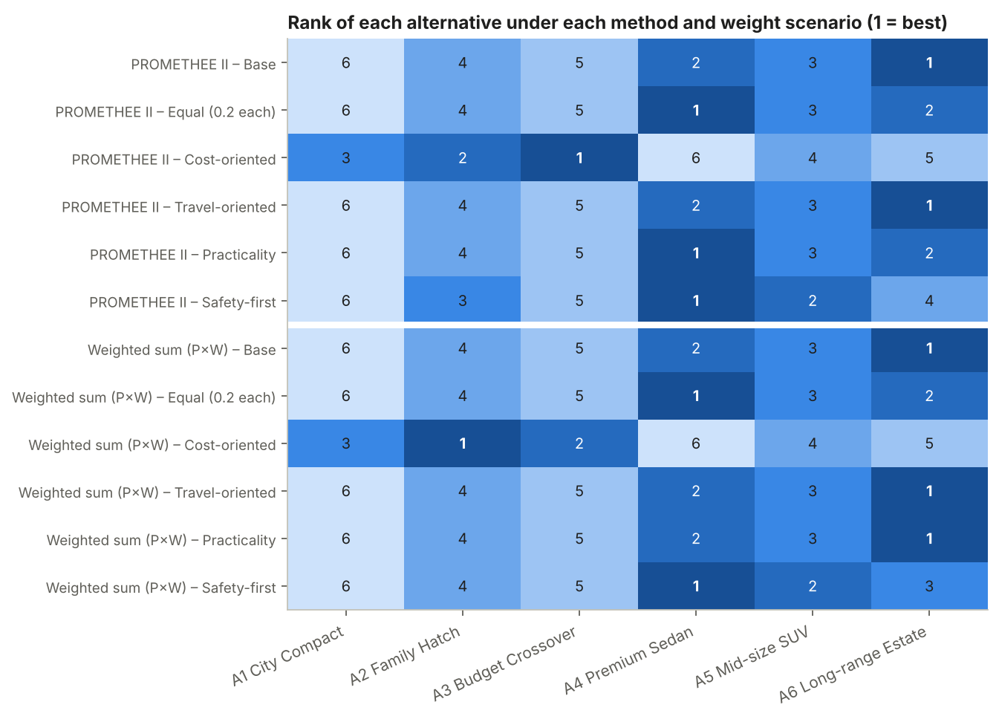

* **Both of my weighting methods (M1 and M2) give the same ranking.** The
  recommendation does not depend on how I turned my priorities into numbers.
* **H2D wins whenever price stops dominating** (equal weights, the balanced
  0.2/0.15 set, or "price matters less"). It is "honestly the better machine",
  as I wrote in Task 1.
* **K2 Plus wins when I want big prints.** It is the volume specialist.
  Without the nozzle criterion, U1 still wins, but only barely over K2 Plus
  (φ = +0.097 vs +0.089), because its price advantage still counts in full.
* **The CORE One is last in all 7 scenarios.** It never comes close to
  winning.

### 4.2 PROMETHEE vs. the Task 1 WSM (P × W)

The WSM uses exactly the Task 1 method: ratio normalisation (min/x for cost
criteria, x/max for benefit criteria) multiplied by the weights. This
reproduces the spreadsheet: U1 0.850, H2D 0.673, K2 0.662, Prusa 0.588.

| Weights | WSM winner (Task 1) | PROMETHEE II winner | τ (PROMETHEE vs WSM) |
|---|---|---|---|
| M1 points | U1 | U1 | 0.67 (2nd/3rd swapped) |
| M2 rank sum | U1 | U1 | 1.00 |
| Equal | H2D | H2D | 1.00 |
| 0.2 / 0.15 balanced | **U1** | **H2D** | 0.67 |
| Price matters less | **U1** | **H2D** | 0.67 |
| No multi-colour needed | U1 (0.800 vs 0.799 – a tie) | U1 (+0.097 vs +0.089 – close) | 1.00 |
| Big prints | K2 Plus | K2 Plus | 0.67 |

* **Both methods choose the Snapmaker U1 with my real weights (M1 and M2).**
  Task 1's main conclusion still holds.
* **2nd and 3rd place swap.** In the WSM, H2D is 2nd (0.673 vs 0.662). In
  PROMETHEE, K2 Plus is 2nd. The WSM gives H2D partial credit on price
  (899/2125 = 0.42 of the best value). PROMETHEE counts H2D's price
  disadvantage as a *full* preference against it, because the gap is more
  than p = 300 € compared with every printer.
* **The WSM is more favourable to U1 when price matters less.** In two
  scenarios the WSM still picks U1 where PROMETHEE picks H2D. The reason is the ratio normalisation: U1 has
  4 nozzles and the others 1–2, so they get only 0.25–0.5 of the nozzle score,
  a very big penalty. In PROMETHEE, the nozzle advantage is limited by the
  preference function, and U1's weak points (noise, volume, speed) count with
  their real size.
* **"No multi-colour needed":** both methods pick U1 by a very small margin.
  The two printers are practically tied here.

## 5. Sensitivity analysis

### 5.1 Weight stability intervals (exact)

PROMETHEE II net flows are linear in the weights, φ = Σⱼ wⱼ φⱼ. When one weight
changes, the other weights keep their proportions, and the point where two
printers swap places can be computed exactly.

| Criterion | Base w | Full ranking unchanged for w ∈ | U1 stays best for w ∈ | Who wins outside |
|---|---|---|---|---|
| Price | 0.30 | [0.291, 0.387] | **[0.148, 1.000]** | < 0.148 → H2D |
| Noise | 0.15 | [0.000, 0.314] | [0.000, 0.364] | > 0.364 → H2D |
| Max speed | 0.10 | [0.000, 0.110] | [0.000, 0.279] | > 0.279 → H2D |
| Build volume | 0.12 | [0.087, 0.302] | [0.000, 0.302] | > 0.302 → K2 Plus |
| Ease of use | 0.08 | [0.000, 0.090] | [0.000, 0.399] | > 0.399 → H2D |
| Nozzles | 0.25 | [0.000, 0.273] | **[0.000, 1.000]** | never |

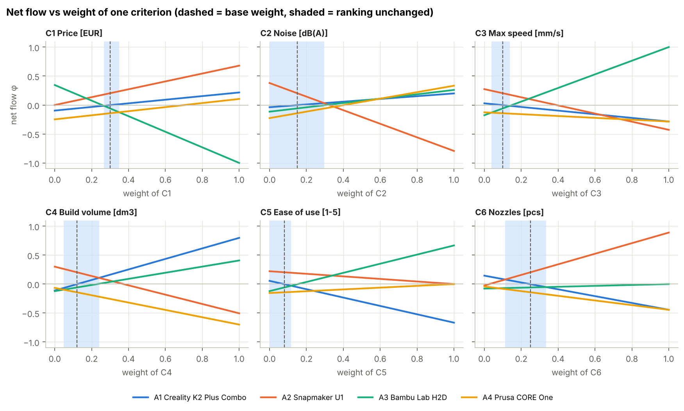

* **The winner is very stable.** U1 stays first for any price weight above
  0.148 and for *any* nozzle weight, even 0. Each of the other criteria would
  need at least 2.4 times its current weight to change the winner.
* **What would beat U1:** H2D needs more weight on noise (> 0.36), speed
  (> 0.28) or ease of use (> 0.40). K2 Plus needs more weight on build volume
  (> 0.30).
* **Positions 2–3 are not stable.** K2 Plus and H2D are almost tied
  (Δφ = 0.014), so the full ranking changes easily (e.g. speed weight above
  0.110). This is the K2 Plus / H2D swap already seen in Section 4.

### 5.2 Monte-Carlo rank acceptability (20 000 weight vectors)

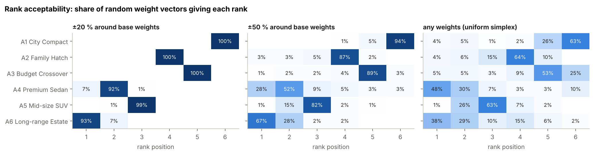

| | ±20 % around M1 | ±50 % around M1 | any weights (uniform) |
|---|---|---|---|
| P(U1 is 1st) | **100 %** | **97 %** | 29 % |
| P(H2D is 1st) | 0 % | 3 % | **62 %** |
| P(K2 Plus is 1st) | 0 % | 0 % | 8 % |
| P(CORE One is 1st) | 0 % | 0 % | 1 % |
| mean rank U1 / K2 / H2D / Prusa | 1.00 / 2.39 / 2.62 / 4.00 | 1.03 / 2.45 / 2.63 / 3.89 | 2.32 / 2.70 / 1.60 / 3.37 |

* **With my weights, U1 is always first.** Even if every weight is uncertain
  by ±50 %, U1 still wins 97 % of the time.
* **With no information about priorities (any weights), H2D is the most
  likely winner (62 %).** Objectively it is the strongest machine. U1 wins
  *because of my priorities*: low budget and multi-colour printing.
* **The CORE One almost never wins** (under 1 % even with random weights).
  It is dominated by the others in most situations.

### 5.3 Sensitivity to preference functions and thresholds

| Variant | Ranking | τ vs base | Winner |
|---|---|---|---|
| all thresholds × 0.25 / × 0.5 | U1 ≻ H2D ≻ K2 ≻ Prusa | 0.67 | U1 |
| all thresholds × 0.75 … × 1.25 | identical to base | 1.00 | U1 |
| all thresholds × 1.5 / × 2 | U1 ≻ K2 ≻ Prusa ≻ H2D | 0.67 | U1 |
| all criteria "usual" (type I) | U1 ≻ H2D ≻ K2 ≻ Prusa | 0.67 | U1 |

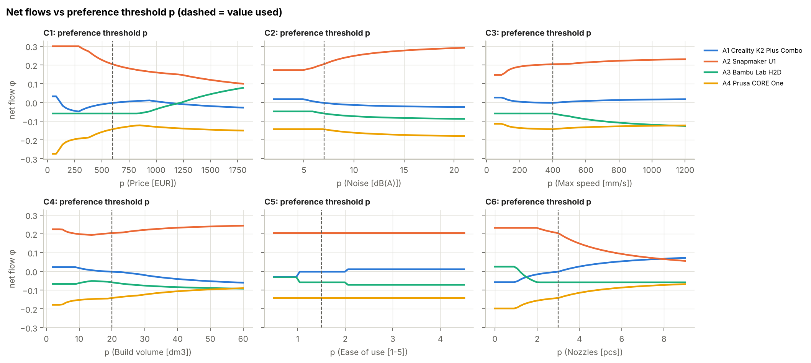

* **U1 is first in every variant.** The recommendation does not depend on my
  threshold choices.
* **Only 2nd/3rd place depends on the thresholds.** The choice is between K2
  Plus and H2D, which are almost tied anyway.
* **Changing a single threshold does not change the winner either.** Any
  price threshold p from 50 to 900 € gives exactly the same ranking. With any
  nozzle threshold p, U1 stays first.

### 5.4 F-PROMETHEE – uncertain values as triangular fuzzy numbers

Some values of my decision matrix are not certain. I replaced them with
**triangular fuzzy numbers (TFN)** (l; m; u): m is the value used so far, and
l and u are the lowest and highest plausible values. The uncertainty comes
from my own notes in Task 1:

| Criterion | Fuzzy values | Why uncertain |
|---|---|---|
| Price | ±5 % for all printers; **U1: (899; 899; 1099)** | prices differ between shops; 899 € for U1 is a sale price, normally 1099 € |
| Noise | ±2 dB for all printers; **K2 Plus: (45; 50; 52)** | values come from different sources; for the K2 Plus the manufacturer states 45 dB, the shop 50 dB |
| Ease of use | ±0.5 point (within 1–5) | my own subjective score |
| Speed, volume, nozzles | crisp | manufacturer specifications |

**How F-PROMETHEE is computed**
* An **α-cut** of a TFN is the interval of values plausible at least to
  degree α:
  * α = 1 gives only m, i.e. the crisp problem;
  * α = 0 gives the whole range [l, u].
* For every α (0, 0.05, …, 1) I compute the **smallest and the largest
  possible net flow** of every printer over all decision matrices inside the
  α-cuts. This set of intervals is the **fuzzy net flow** of the printer.
* This is exact, because the net flow is monotone. φ(a) is largest when a's
  own values are at the good end of their intervals and every other printer's
  values are at the bad end, and smallest in the opposite case.
* In a second case the **weights are fuzzy as well** (±20 %:
  (0.8w; w; 1.2w)). Because φ is linear in the weights, the extreme weights
  are found exactly with a small linear programme.
* To check whether U1 *certainly* wins, I compute the smallest possible
  φ(U1) − φ(b) over everything plausible at level α. If it is positive for
  every b, U1 beats all printers in every plausible case at that α.
* Ranking: each fuzzy net flow is defuzzified as the average of its α-cut
  midpoints.

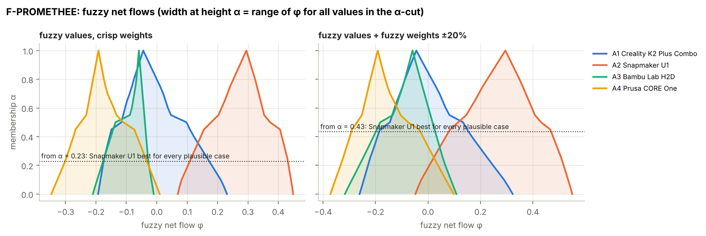

| Printer | φ crisp (α = 1) | φ range α = 0, fuzzy values | defuzzified φ | φ range α = 0, fuzzy values + weights ±20 % | defuzzified φ |
|---|---|---|---|---|---|
| A2 Snapmaker U1 | +0.295 | [+0.070, +0.449] | **+0.278** | [−0.048, +0.550] | **+0.274** |
| A1 Creality K2 Plus | −0.044 | [−0.193, +0.231] | −0.018 | [−0.261, +0.323] | −0.014 |
| A3 Bambu Lab H2D | −0.059 | [−0.210, −0.010] | −0.081 | [−0.317, +0.108] | −0.078 |
| A4 Prusa CORE One | −0.192 | [−0.347, +0.010] | −0.179 | [−0.372, +0.098] | −0.169 |

* **The F-PROMETHEE ranking is the same as the crisp one: U1 ≻ K2 Plus ≻
  H2D ≻ CORE One**, in both cases. The uncertainty does not change the
  recommendation.
* **U1 has the only fuzzy net flow that stays positive** over the whole
  support (fuzzy values case).
* **Defuzzified U1 is slightly lower than crisp U1** (0.278 vs 0.295). Its
  price TFN is one-sided (899 → 1099 €): the price can only go up.
* **Guaranteed winner:**
  * with fuzzy values, U1 beats every printer in every plausible case for
    **α ≥ 0.23**;
  * with fuzzy values and fuzzy weights, for **α ≥ 0.43**.
* **Where U1 could lose:** only at the bottom of the TFNs, when the K2 Plus
  is as quiet as the manufacturer claims (45 dB) *and* U1 costs its regular
  1099 €. Even then this needs the most unfavourable values on all uncertain
  criteria at once.
* **The K2 Plus has the widest fuzzy flow.** Its noise value has the
  largest uncertainty, 45–52 dB.

### 5.5 What if the Bambu H2D goes on sale? (continues Task 1, Section 6)

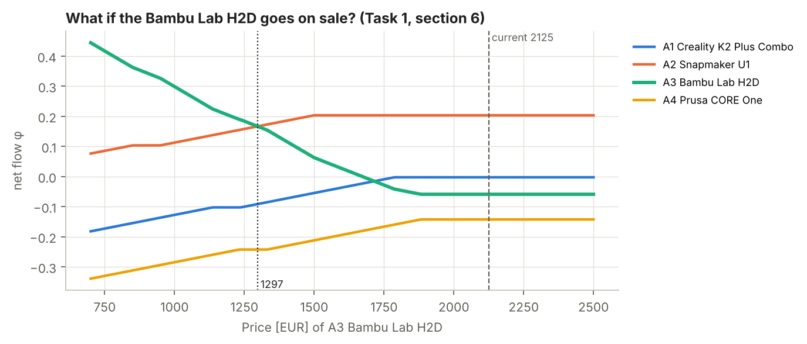

| H2D price [EUR] | φ U1 | φ H2D | Winner |
|---|---|---|---|
| 2125 (now) | +0.295 | −0.059 | U1 |
| 1600 | +0.295 | −0.059 | U1 |
| 1300 | +0.295 | +0.116 | U1 |
| **≈ 1096** | | | tie |
| 1000 | +0.215 | +0.368 | **H2D** |
| 700 | +0.135 | +0.501 | **H2D** |

* **PROMETHEE: H2D becomes the best choice below about 1096 EUR**, a discount
  of about 48 %.
* In Task 1 the WSM said H2D "doesn't win even if it costs the same as the
  U1". **PROMETHEE gives a different answer.** In the WSM, U1's nozzle
  advantage (4 vs 2) is worth a fixed 0.125 of the score, which H2D cannot
  make up. In PROMETHEE, H2D's clear superiority on speed, ease of use,
  volume and noise outweighs it once price no longer works against H2D.
* **Above about 1580 EUR, H2D's φ stops changing.** It is already more than
  300 € (= p) more expensive than every other printer, so further price
  increases cannot make it any worse on price.

## 6. Extension – efficiency measuring

**Why this extension.** The goal of Task 1 was literally *"find the printer
that gives me the most for my money"*. An efficiency analysis answers exactly
that question: it separates **what I pay** from **what I get**.
* Group decision-making is not useful here: there is only one decision maker.
* Sorting would classify the printers, but it would not show the trade-off
  between money and quality.
* PROMETHEE V (portfolio) only makes sense when alternatives are combined,
  e.g. a fleet. I buy one printer, so it does not apply.

### 6.1 Input vs. output flows and the efficient frontier

The criteria are split into the **input (cost)** criterion (price, weight
0.30) and the **output (benefit)** criteria (noise, speed, volume, ease of use, nozzles, weights
0.15 / 0.10 / 0.12 / 0.08 / 0.25, renormalised to sum to 1). From the same
unicriterion flows φⱼ as in the ranking I compute:

* **φ benefit** = weighted average of φⱼ over the 5 benefit criteria
  (what the printer offers),
* **φ cost** = φ of the price criterion (higher = cheaper).

Together they give back the full net flow: φ = 0.30·φ cost + 0.70·φ benefit.

A printer is **efficient** if no other printer is at least as good on both
scores and strictly better on one (Pareto, non-dominated).

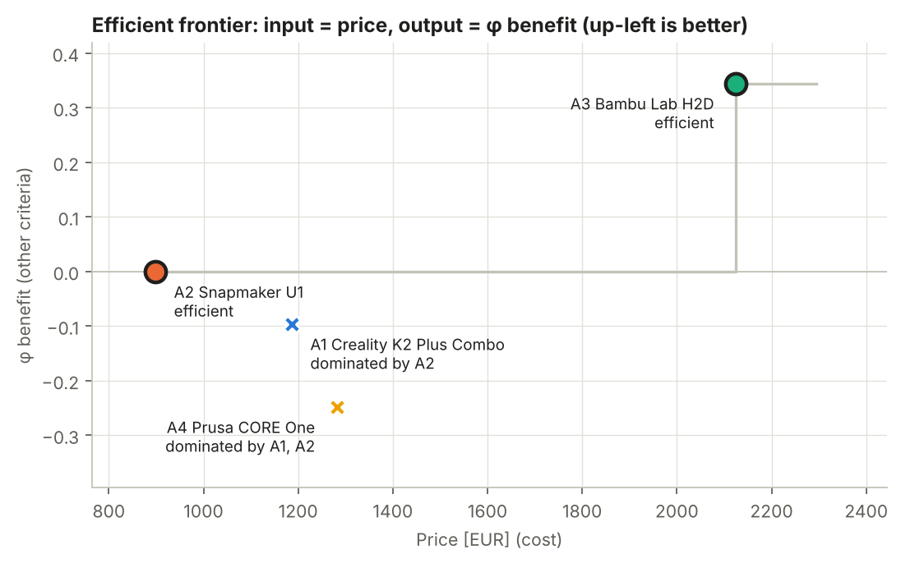

| Printer | Price | φ benefit | φ cost | Efficient? |
|---|---|---|---|---|
| A2 Snapmaker U1 | 899 € | 0.000 | +0.984 | **yes**, the cheapest |
| A1 Creality K2 Plus | 1187 € | −0.096 | +0.076 | no, dominated by U1 |
| A4 Prusa CORE One | 1282 € | −0.248 | −0.060 | no, dominated by U1 and K2 Plus |
| A3 Bambu Lab H2D | 2125 € | **+0.345** | −1.000 | **yes**, the best |

* **Only two printers are efficient: U1 and H2D.** For every other printer
  there is one that is both cheaper and better.
* **K2 Plus and CORE One are dominated by U1.** U1 is cheaper (by 288 € and
  383 €) and offers more on the benefit criteria. With the efficiency
  analysis they can be excluded without even discussing weights between cost
  and benefit.
* **The only real trade-off is U1 → H2D:** +1226 € buys +0.345 φ benefit,
  about **355 € for every +0.1 of benefit flow**. H2D is quieter, twice as
  fast, has a larger volume and is the easiest to use, but has 2 nozzles
  instead of 4.

### 6.2 Reading the frontier – best printer for a given budget

For a given budget, the frontier shows the best printer I can afford: among
all printers with price ≤ budget, the one with the highest benefit flow.

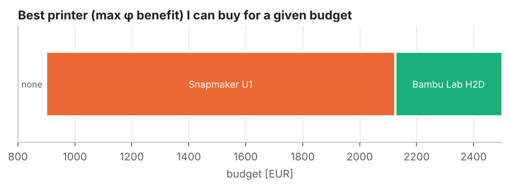

| Budget | Best choice |
|---|---|
| below 899 € | nothing affordable |
| 899 – 2124 € | **Snapmaker U1** |
| from 2125 € | **Bambu Lab H2D** |

* A budget between 899 € and 2124 € never buys anything better than U1. K2
  Plus and CORE One are never chosen, at any budget. This confirms that they
  are dominated.
* **With my budget of 2500 €:**
  * If price is *only a limit*, the best printer I can afford is H2D.
  * If price is also a *criterion* (weight 0.30, as in my problem), the full
    net flow picks **U1**.

  The difference is exactly the question "do I want the best printer I can
  afford, or the best value for money?". My goal in Task 1 was value for
  money, so U1 is my choice.

### 6.3 Robustness of the efficient set

Share of random weight vectors (20 000) for which each printer is efficient:

| Printer | ±20 % | ±50 % | any weights |
|---|---|---|---|
| A2 Snapmaker U1 | **100 %** | **100 %** | **100 %** |
| A3 Bambu Lab H2D | **100 %** | **99.7 %** | 93 % |
| A1 Creality K2 Plus | 8 % | 30 % | 59 % |
| A4 Prusa CORE One | 0 % | 0.1 % | 19 % |

* **U1 is always efficient**, because it is the cheapest printer.
* **H2D is efficient in almost every case**, because it offers the most.
* **K2 Plus becomes efficient only when** the benefit weights shift toward
  build volume.
* **CORE One is practically never efficient**, so it is the weakest choice
  for my money.

## 7. Conclusions

1. **Recommendation: Snapmaker U1.**
   * It is first in PROMETHEE II with both Task 1 weighting methods, with a
     large margin (φ = +0.295, the only positive net flow).
   * It outranks all three other printers in PROMETHEE I.
   * It is efficient (the cheapest printer on the efficient frontier) and
     dominates K2 Plus and CORE One: they are more expensive *and* offer less.
   * It stays first for ±20 % weight uncertainty (100 %), ±50 % (97 %), and
     every threshold variant.
   * F-PROMETHEE gives the same ranking with uncertain prices, noise values
     and ease-of-use scores. U1 is the guaranteed winner from α = 0.23 (from
     α = 0.43 with fuzzy weights as well).

   **My Task 1 guess and the WSM result are confirmed by PROMETHEE.**
2. **Why U1 wins:** my two most important criteria, price (0.30) and nozzles
   (0.25), are exactly U1's strengths. Its weaknesses (loudest, small volume,
   slowest) are on criteria with lower weights.
3. **Bambu H2D is the objectively strongest printer.** It wins with equal
   weights, when price matters less, and in 62 % of random weight vectors.
   It is the only other efficient printer: the best printer I can buy if I
   am willing to pay 1226 € more.
   It loses only because of its price, and it would become my best choice
   below about 1096 €. This is where PROMETHEE differs most from the Task 1
   WSM, which said H2D never wins.
4. **Creality K2 Plus is the choice if I want big prints.** Without
   multi-colour it is practically tied with U1 (in both PROMETHEE and WSM).
5. **Prusa CORE One is consistently last.** In the efficiency analysis it is
   dominated by both U1 and K2 Plus, which are cheaper and offer more.
6. **Weak points of the analysis:**
   * As already noted in Task 1: only 4 printers, noise values from different
     sources (handled here with q = 2 dB), and ease of use is a subjective
     score.
   * New in PROMETHEE: the preference thresholds are also my own judgement. The threshold analysis shows they do not
     affect the winner, but they do affect places 2 and 3.

---

### Reproducing

```bash
pip install -r requirements.txt
python run_analysis.py
python -m pytest -q
```
